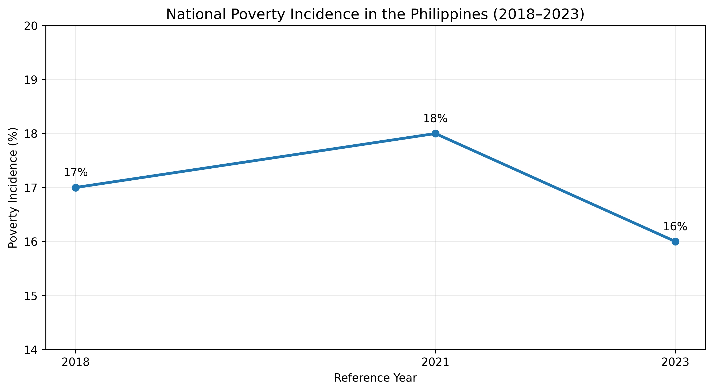
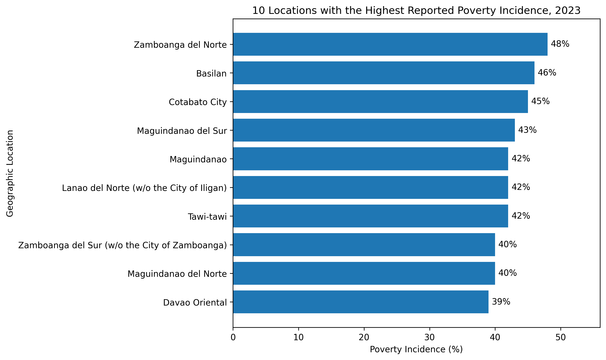
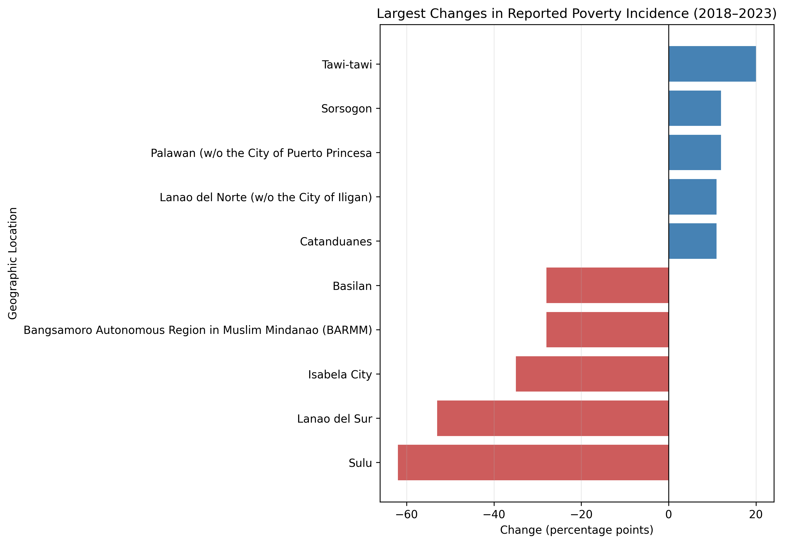

# Philippines Poverty Incidence Analysis (2018–2023)

## Overview

This project analyzes reported poverty incidence across geographic areas in the Philippines using Python and PostgreSQL. It focuses on data cleaning, SQL querying, data quality validation, and comparisons of reported poverty incidence across 2018, 2021, and 2023.

The goal is to explore how reported poverty incidence differs across locations and how estimates changed between the available reference years.

## Research Questions

- How did national poverty incidence change between 2018, 2021, and 2023?
- Which geographic areas had the highest reported poverty incidence in 2023?
- Which locations experienced the largest increases or decreases between 2018 and 2023?
- What data quality issues and geographic comparability limitations should be considered when interpreting the results?

## Data Source

**Source:** Philippine Statistics Authority (PSA), OpenSTAT

**Dataset:** Annual Per Capita Poverty Threshold and Poverty Incidence Among Population with Measures of Precision, by Region, Province and Highly Urbanized Cities: 2018, 2021, and 2023.

[Access the official PSA poverty statistics](https://openstat.psa.gov.ph/Database/Demographic-and-Social-Statistics/Poverty)

The cleaned dataset contains 414 records covering 138 geographic labels across three reference years: 2018, 2021, and 2023.

The dataset includes national, regional, provincial, and city-level geographic labels. These geographic levels are not necessarily directly comparable.

## Tools and Technologies

- **Python:** Data inspection and cleaning using pandas and NumPy
- **PostgreSQL:** Data storage, exploratory SQL analysis, views, functions, and data quality checks
- **pgAdmin:** Database management and SQL execution
- **Jupyter Notebook:** Documenting data inspection and cleaning
- **GitHub:** Version control and project documentation

## Methodology

1. **Data inspection and cleaning:** Inspected the original dataset, standardized geographic labels where needed, and preserved unavailable estimates as NULL.
2. **Database design:** Created a PostgreSQL table with a composite primary key and constraints for valid years and poverty incidence percentages.
3. **Exploratory SQL analysis:** Examined missing values, checked for duplicate records, ranked geographic areas, and calculated changes between reference years.
4. **Reusable database objects:** Created views for the national trend and 2018–2023 comparisons, along with a function to calculate changes for a selected location.
5. **Data quality validation:** Checked row counts, year coverage, duplicate location-year combinations, percentage ranges, and missing estimates.

## Preliminary Findings

- **National trend:** Reported poverty incidence was 17% in 2018, 18% in 2021, and 16% in 2023.
- **Highest reported incidence in 2023:** Zamboanga del Norte had a reported incidence of 48%, followed by Basilan at 46% and Cotabato City at 45%.
- **Largest observed increase:** Tawi-tawi increased from 22% in 2018 to 42% in 2023, a difference of 20 percentage points.
- **Data completeness:** Six poverty incidence estimates were missing across the three reference years.

These findings are descriptive comparisons of reported estimates. They do not establish the causes of changes in poverty incidence.

## Visualizations

### 1. National Poverty Incidence (2018–2023)

### 2. Locations with the Highest Reported Poverty Incidence in 2023

### 3. Largest Changes in Reported Poverty Incidence (2018–2023)

**Interpretation note:** The dataset contains estimates for 2018, 2021, and 2023, rather than continuous annual observations. Geographic levels vary across the dataset, so location rankings and changes should be interpreted with care.

## Data Limitations

- The dataset contains three reference years, not continuous annual observations.
- Missing estimates are retained as NULL rather than treated as zero.
- Geographic labels include multiple administrative levels, and some provincial estimates exclude separately reported cities.
- Geographic definitions and source precision measures should be reviewed before drawing conclusions from large changes between years.
- One source geographic label for Palawan has a formatting issue that requires verification against the original source.

## Repository Structure

- `data/raw/` — Original source data
- `data/processed/` — Cleaned dataset used for analysis
- `notebooks/` — Data inspection and cleaning notebook
- `sql/` — Exploratory queries, database views and functions, data quality checks, and SQL documentation
- `outputs/` — Space for generated tables and visualizations
- `src/` — Space for reusable Python code
- `tests/` — Space for project tests

## Future Improvements

- Develop visualizations to communicate geographic differences and changes over time.
- Investigate geographic comparability and source precision measures.
- Add automated tests for data cleaning and database outputs.
- Expand the analysis with additional reference years or related socioeconomic indicators where comparable data are available.
